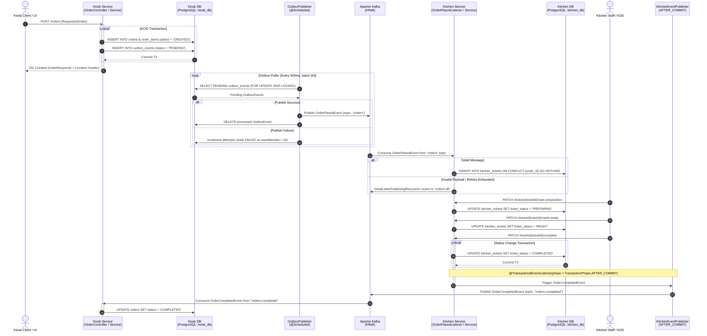

# 🍔 Kiosk Platform – Event-Driven Microservices Platform

- [System Architecture & Event Flow](#%EF%B8%8F-system-architecture--event-flow)
- [Architectural & Reliability Patterns](#-architectural--reliability-patterns)
- [Tech Stack](#%EF%B8%8F-tech-stack)
- [Getting Started](#-getting-started)
- [REST API Reference](#-rest-api-reference)
- [Apache Kafka Topics](#-apache-kafka-topics)
- [Database Schema & Migrations](#%EF%B8%8F-database-schema--migrations)
- [Testing & Testcontainers](#-testing--testcontainers)
- [Error Handling (RFC 9457)](#%EF%B8%8F-error-handling-rfc-9457)
- [License](#-license)

An event-driven microservices backend handling real-time restaurant order placement from self-service kiosks and managing kitchen preparation workflows. Built with **Spring Boot 4**, **Apache Kafka (KRaft)** and **PostgreSQL 16**, the system demonstrates production-grade reliability and resilience patterns for distributed architectures.

---

## ⚡ Highlights

* **Transactional Outbox Pattern:** Atomic order creation and domain event capture in a single ACID transaction, eliminating the Dual-Write Problem.
* **Idempotent Consumer:** Incoming events are deduplicated at the database layer via PostgreSQL.
* **Resilient Kafka Processing:** Transient errors trigger backoff retries, while non-retryable exceptions and poisoned payloads route to a Dead-Letter Topic (`orders-dlt`).
* **Post-Commit Event Publishing:** Completed ticket events emit to Kafka strictly after database transaction commit via `@TransactionalEventListener(phase = AFTER_COMMIT)`.
* **Database per Service:** Fully isolated PostgreSQL databases per microservice managed by versioned Flyway migrations.
---

## 📋 Table of Contents

- [System Architecture & Event Flow](#system-architecture--event-flow)
- [Architectural & Reliability Patterns](#architectural--reliability-patterns)
- [Tech Stack](#tech-stack)
- [Getting Started](#getting-started)
- [REST API Reference](#rest-api-reference)
- [Apache Kafka Topics](#apache-kafka-topics)
- [Database Schema & Migrations](#database-schema--migrations)
- [Testing & Testcontainers](#testing--testcontainers)
- [Error Handling (RFC 9457)](#error-handling-rfc-9457)

---

## 🏛️ System Architecture & Event Flow

The platform consists of two collaborating microservices:
1. **`kiosk-service`:** Handles customer order creation, daily sequential order numbering, and outbox event persistence.
2. **`kitchen-service`:** Consumes customer orders, manages preparation workflows, and notifies downstream services upon order completion.



---

## 🎯 Architectural & Reliability Patterns

* **Transactional Outbox Pattern (`kiosk-service`):**
  Placing an order atomically persists both the `Order` aggregate and an `OutboxEvent` in a single ACID database transaction. A dedicated worker (`OutboxPublisher`) periodically queries pending rows using pessimistic concurrency control (`FOR UPDATE SKIP LOCKED`) backed by a PostgreSQL partial index (`WHERE status = 'PENDING'`), forwarding events to the `orders` topic.
* **Idempotent Consumer (`kitchen-service`):**
  `OrderPlacedListener` guarantees idempotency using PostgreSQL native `INSERT INTO kitchen_tickets ... ON CONFLICT (order_id) DO NOTHING`. Redelivered or replayed Kafka messages are ignored without producing duplicate tickets.
* **Dead-Letter Topic (DLT) & Retry Policy (`kitchen-service`):**
  Configured with `DefaultErrorHandler` and `DeadLetterPublishingRecoverer`. Transient errors undergo retry with exponential/fixed backoff (2 attempts, 2000 ms). Non-retryable exceptions (e.g. malformed JSON, `JacksonException`, `IllegalArgumentException`) bypass retries and publish directly to `orders-dlt`.
* **Post-Commit Event Emission (`kitchen-service`):**
  Order completion events trigger via `@TransactionalEventListener(phase = TransactionPhase.AFTER_COMMIT)` in `KitchenEventPublisher`. This ensures events are published only after the database transaction is fully committed, eliminating ghost/phantom events.
* **Domain State Machines:**
  Both aggregates enforce invariant checks:
  * `Order`: `CREATED` &rarr; `COMPLETED`
  * `KitchenTicket`: `RECEIVED` &rarr; `PREPARING` &rarr; `READY` &rarr; `COMPLETED`
  Invalid transitions throw domain exceptions mapped to HTTP `409 Conflict`.
* **Daily Sequential Order Numbering:**
  `OrderNumberGenerator` generates customer-facing friendly identifiers (`Z-001`, `Z-002`, etc.) and automatically resets the sequence at midnight every day.

---

## 🛠️ Tech Stack

| Area | Technologies |
| :--- | :--- |
| **Language & Framework** | Java 21, Spring Boot 4, Spring Framework |
| **Persistence & ORM** | PostgreSQL 16, Spring Data JPA, Hibernate |
| **Database Migrations** | Flyway (`V1__...`, `V2__...`) |
| **Messaging & Streaming** | Apache Kafka (KRaft mode), Spring for Apache Kafka |
| **API & Documentation** | Spring Web, SpringDoc OpenAPI 3 / Swagger UI, Jakarta Validation, RFC 9457 ProblemDetail |
| **Containerization** | Docker, Docker Compose, Kafka UI |
| **Testing** | JUnit 5, Mockito, AssertJ, Spring MockMvc, Testcontainers |

---

## 🚀 Getting Started

### Prerequisites
* **Docker & Docker Compose v2** (mandatory to run the full stack)
* **JDK 21** & **Maven** (optional, only for running services or tests locally outside Docker)

### 1. Launch with Docker Compose
Clone the repository and start all microservices, databases, and infrastructure with one command:

```bash
git clone https://github.com/a1queen/kiosk-platform.git
cd kiosk-platform
docker compose up -d --build
```

### 2. Service Endpoints & Web Consoles

| Service | Port | Description / URL | Credentials |
| :--- | :--- | :--- | :--- |
| **Kiosk Service** | `8080` | [http://localhost:8080/swagger-ui.html](http://localhost:8080/swagger-ui.html) (OpenAPI / Swagger UI) | — |
| **Kitchen Service** | `8081` | [http://localhost:8081/swagger-ui.html](http://localhost:8081/swagger-ui.html) (OpenAPI / Swagger UI) | — |
| **Kafka UI** | `8085` | [http://localhost:8085](http://localhost:8085) (Topic and message explorer) | — |
| **Kiosk Database** | `5432` | PostgreSQL: `localhost:5432/kiosk_db` | `kiosk_user` / `kiosk_password` |
| **Kitchen Database** | `5433` | PostgreSQL: `localhost:5433/kitchen_db` | `kitchen_user` / `kitchen_password` |

---

## 📌 REST API Reference

### Kiosk Service (`http://localhost:8080`)

| Method | Endpoint | Description | Status Code |
| :--- | :--- | :--- | :--- |
| `POST` | `/orders` | Place a new order and record outbox event | `201 Created` (`Location` header) |
| `GET` | `/orders` | List paginated orders (`page`, `size`, `sort`) | `200 OK` |
| `GET` | `/orders/{id}` | Get order details by UUID | `200 OK` / `404 Not Found` |

#### Example: Place an Order (`POST /orders`)
```bash
curl -i -X POST http://localhost:8080/orders \
  -H "Content-Type: application/json" \
  -d '{
    "totalAmount": 42.50,
    "items": [
      {
        "productName": "Double Cheeseburger",
        "quantity": 2,
        "notes": ["No onions", "Extra cheese"]
      },
      {
        "productName": "Large Fries",
        "quantity": 1,
        "notes": []
      }
    ]
  }'
```

---

### Kitchen Service (`http://localhost:8081`)

| Method | Endpoint | Description | Status Code |
| :--- | :--- | :--- | :--- |
| `GET` | `/tickets` | List paginated kitchen tickets | `200 OK` |
| `GET` | `/tickets/{ticketId}` | Get ticket details by UUID | `200 OK` / `404 Not Found` |
| `PATCH` | `/tickets/{ticketId}/start-preparation` | Transition status `RECEIVED` &rarr; `PREPARING` | `200 OK` / `409 Conflict` |
| `PATCH` | `/tickets/{ticketId}/mark-ready` | Transition status `PREPARING` &rarr; `READY` | `200 OK` / `409 Conflict` |
| `PATCH` | `/tickets/{ticketId}/complete` | Transition status `READY` &rarr; `COMPLETED` | `200 OK` / `409 Conflict` |

#### Example: Ticket Lifecycle Transitions
```bash
# 1. Start preparation
curl -X PATCH http://localhost:8081/tickets/<ticketId>/start-preparation

# 2. Mark as ready
curl -X PATCH http://localhost:8081/tickets/<ticketId>/mark-ready

# 3. Complete ticket (triggers 'orders-completed' Kafka event)
curl -X PATCH http://localhost:8081/tickets/<ticketId>/complete
```

---

## 📬 Apache Kafka Topics

| Topic Name | Producer | Consumer | Key | Description |
| :--- | :--- | :--- | :--- | :--- |
| `orders` | `kiosk-service` (`OutboxPublisher`) | `kitchen-service` (`OrderPlacedListener`) | `orderId` | Broadcasts new customer order details to the kitchen. |
| `orders-completed` | `kitchen-service` (`KitchenEventPublisher`) | `kiosk-service` (`OrderStatusChangedListener`) | `orderId` | Notifies that food preparation has finished. |
| `orders-dlt` | `kitchen-service` (`DeadLetterPublishingRecoverer`) | Operations / Alerting | Original Key | Dead-letter queue for poisoned or unprocessable messages. |

### Payload Example: `OrderPlacedEvent` (`orders` topic)
```json
{
  "eventId": "b7a2d4f1-6789-4b3e-9012-3456789abcde",
  "orderId": "a1b2c3d4-e5f6-7890-abcd-ef1234567890",
  "orderNumber": "Z-001",
  "createdAt": "2026-10-19T14:30:00.123456Z",
  "items": [
    {
      "productName": "Double Cheeseburger",
      "quantity": 2,
      "notes": ["No onions", "Extra cheese"]
    },
    {
      "productName": "Large Fries",
      "quantity": 1,
      "notes": []
    }
  ]
}
```

---

## 🗄️ Database Schema & Migrations

Both services manage their own isolated PostgreSQL schema via Flyway migrations.

### `kiosk_db` (`kiosk-service`)
* `V1__create_orders_schema.sql`:
  * `orders`: Primary entity (`id`, `order_number`, `status`, `total_amount`, `created_at`, `updated_at`).
  * `order_items`: Line items (`id`, `order_id`, `product_name`, `quantity`, `notes` as `TEXT[]`).
* `V2__create_outbox_events_schema.sql`:
  * `outbox_events`: Outbox table (`id`, `aggregate_type`, `aggregate_id`, `payload` as `JSONB`, `status`, `attempts`, `created_at`).
  * **Partial Index:** `idx_outbox_events_pending` on `(created_at) WHERE status = 'PENDING'`.

### `kitchen_db` (`kitchen-service`)
* `V1__create_kitchen_tickets.sql`:
  * `kitchen_tickets`: Ticket entity (`id`, `order_id`, `order_number`, `items` as `JSONB`, `received_at`).
  * **Unique constraint:** `uq_kitchen_tickets_order_id` ensures idempotent ingestion.
* `V2__add_ticket_status.sql`:
  * Adds `ticket_status` column (`RECEIVED`, `PREPARING`, `READY`, `COMPLETED`).
  * Index: `idx_kitchen_tickets_status` on `(ticket_status)`.

---

## 🧪 Testing & Testcontainers

The test suite covers domain unit logic, MVC controllers, and full end-to-end integration flows.

### Running Tests Locally

```bash
# Run unit & integration tests in kiosk-service
cd kiosk-service
./mvnw clean test

# Run unit & integration tests in kitchen-service
cd ../kitchen-service
./mvnw clean test
```

> **Note:** Docker must be running when executing the complete test suite so Testcontainers can start the required Kafka and PostgreSQL containers.

---

## ⚠️ Error Handling (RFC 9457)

All validation errors and domain state conflicts return standard RFC 9457 `ProblemDetail` payloads.

### 1. Validation Error (`400 Bad Request`)
Returned when request payload constraints fail:
```json
{
  "type": "urn:problem-type:validation-error",
  "title": "Invalid Request Content",
  "status": 400,
  "detail": "Request validation failed",
  "instance": "/orders",
  "invalidFields": {
    "totalAmount": "Total amount must be greater than zero",
    "items[0].productName": "Product name must not be blank"
  }
}
```

### 2. State Conflict (`409 Conflict`)
Returned when an illegal state machine transition is attempted:
```json
{
  "type": "urn:problem-type:ticket-state-conflict",
  "title": "Ticket State Conflict",
  "status": 409,
  "detail": "Only tickets with READY status can move to COMPLETED, current: RECEIVED",
  "instance": "/tickets/f9e8d7c6-b5a4-3210-fedc-ba0987654321/complete"
}
```

---

## 📄 License
This project is licensed under the MIT License. See [LICENSE](LICENSE) for details.
