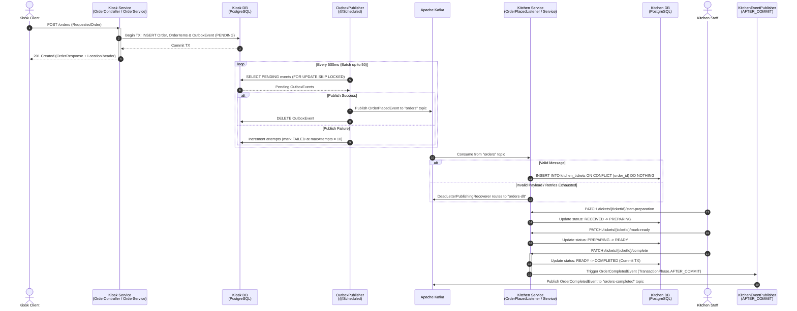
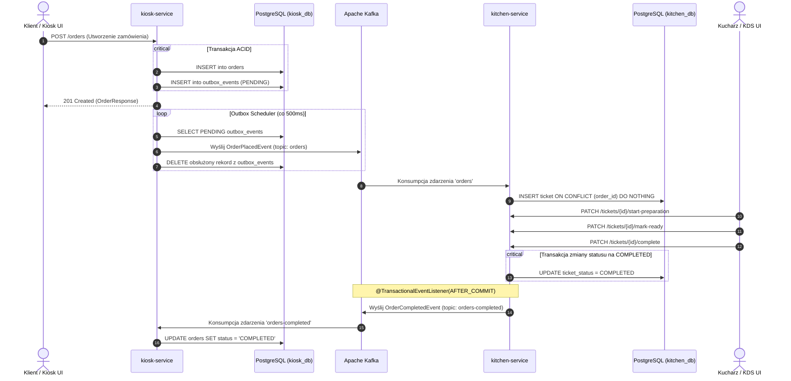

# 🍔 Kiosk Platform – Event-Driven Microservices Platform

[](https://openjdk.org/projects/jdk/21/)
[](https://spring.io/projects/spring-boot)
[](https://kafka.apache.org/)
[](https://www.postgresql.org/)
[](https://www.docker.com/)


An event-driven microservices backend that handles real-time restaurant order placement from self-service kiosks and manages kitchen preparation workflows. Built with **Spring Boot 4**, **Apache Kafka**, and **PostgreSQL**, the system demonstrates production-grade reliability patterns for distributed architectures.

---
## Highlights

**Transactional outbox:**  an order and its event are written in one database transaction, so there are no lost or "ghost" events between the commit and the Kafka publish.\
**Idempotent consumer:** a redelivered event never creates a second ticket.\
**Retries and a dead-letter topic** for messages that cannot be processed.\
**Database per service** and a JSON event contract instead of shared classes.\
**Versioned schema:** Flyway migrations, validated by Hibernate on startup.\
**One command to run everything**: `docker compose up`.

## 🏛️ System Architecture & Event Flow

The system consists of two collaborating microservices: **Kiosk Service** (handling customer order creation and outbox publishing) and **Kitchen Service** (managing kitchen tickets and preparation state transitions).


How a message flows
`POST /orders` validates the request and, in a single transaction, saves the order and an outbox row.
A scheduled outbox publisher reads pending rows (`FOR UPDATE SKIP LOCKED`, safe with several instances) and sends them to the `orders` topic.
kitchen-service consumes the message and creates a ticket. A duplicate is ignored thanks to the unique `order_id`.
A message that fails is retried, then sent to `orders-dlt`. Malformed messages skip the retries.
When staff complete a ticket, kitchen-service publishes `OrderCompletedEvent` to `orders-completed` after the transaction commits.
---

## Architectural & Reliability Patterns

* **Transactional Outbox Pattern (`KioskService`):** Placing an order persists both the `Order` aggregate (with its `OrderItem` collection) and an `OutboxEvent` record within a single ACID database transaction, preventing dual-write inconsistencies. A scheduled worker (`OutboxPublisher`) polls the `outbox_events` table using pessimistic locking (`FOR UPDATE SKIP LOCKED`) backed by a PostgreSQL partial index (`WHERE status = 'PENDING'`), publishes events to the `orders` Kafka topic, and tracks retry attempts (`attempts`, transitioning to `FAILED` at 10 attempts).
* **Idempotent Consumer (`kitchenservice`):** `OrderPlacedListener` processes incoming `OrderPlacedEvent` messages idempotently by executing a native PostgreSQL `INSERT INTO kitchen_tickets ... ON CONFLICT (order_id) DO NOTHING` query, safely ignoring duplicate deliveries.
* **Dead-Letter Topic (DLT) & Retry Policy (`kitchenservice`):** `KafkaConsumerConfig` configures a `DefaultErrorHandler` with a `DeadLetterPublishingRecoverer`. Transient errors are retried via `FixedBackOff` (2 retries with a 2,000 ms interval), whereas non-retryable deserialization and validation exceptions (`JacksonException`, `NullPointerException`, `IllegalArgumentException`) are immediately routed to the `orders-dlt` topic.
* **Post-Commit Event Publishing (`kitchenservice`):** Completing a kitchen ticket triggers `KitchenEventPublisher` annotated with `@TransactionalEventListener(phase = TransactionPhase.AFTER_COMMIT)`, ensuring that `OrderCompletedEvent` is published to the `orders-completed` topic only after the database transaction commits.
* **Rich Domain Models & State Machines:** Both `Order` (`CREATED` -> `COMPLETED`) and `KitchenTicket` (`RECEIVED` -> `PREPARING` -> `READY` -> `COMPLETED`) enforce state transition invariants and throw domain exceptions (`OrderStateException`, `TicketStateException`) mapped to HTTP `409 Conflict`.
* **Daily Sequential Order Numbering (`OrderNumberGenerator`):** Generates human-readable order numbers (`Z-001`, `Z-002`, etc.) and automatically resets the counter to `1` at midnight every day.




---

## 🎯 Kluczowe Wzorce i Decyzje Architektoniczne

* **Transactional Outbox Pattern (`kiosk-service`)**:
  Zapis encji `Order` oraz zdarzenia domenowego do tabeli `outbox_events` odbywa się atomowo w ramach jednej lokalnej transakcji bazodanowej. Dedykowany komponent `OutboxPublisher` asynchronicznie przesyła zdarzenia do brokera Kafka, eliminując problem utraty danych w przypadku awarii sieci lub brokera (Dual-Write Problem).

* **Idempotent Consumer (`kitchen-service`)**:
  Konsument Kafki jest w pełni idempotentny dzięki unikalnemu kluczowi `order_id` oraz zapytaniu `ON CONFLICT (order_id) DO NOTHING`. Nawet w przypadku retransmisji wiadomości z Kafki stan bazy danych pozostaje spójny.

* **Spring TransactionalEventListener (phase = AFTER_COMMIT)**:
  W `kitchen-service` zdarzenie zakończenia zamówienia jest wysyłane do Kafki dopiero wtedy, gdy lokalna transakcja bazodanowa zmieniająca status biletu zostanie pomyślnie zatwierdzona w PostgreSQL. Zapobiega to publikacji zdarzeń o stanie, który w bazie uległby rollbackowi (*Phantom Events*).

* **Dead Letter Topic (DLT) & Resiliency**:
  Obsługa błędów konsumenta za pomocą `DefaultErrorHandler` z `DeadLetterPublishingRecoverer`. Uszkodzone komunikaty (np. nieprawidłowy JSON, `JacksonException`) są po określonej liczbie ponowień przekierowywane na dedykowany temat DLT (`orders-dlt`), zapobiegając blokowaniu kolejki (Poison Pill).

* **Database per Service & Migracje Flyway**:
  Każdy mikroserwis posiada całkowicie odizolowaną bazę danych zarządzaną wersjonowanymi skryptami migracyjnymi Flyway (`V1__...`, `V2__...`).

* **OpenAPI / Swagger 3 & RFC 7807**:
  Wszystkie endpointy są udokumentowane w standardzie OpenAPI / Swagger UI. Błędy biznesowe i walidacyjne zwracane są w ustandaryzowanym formacie RFC 7807 `ProblemDetail`.

---

## 🛠️ Stack Technologiczny

| Obszar | Technologie |
|---|---|
| **Język i Framework** | Java 21, Spring Boot (Web, Data JPA, Validation) |
| **Messaging** | Apache Kafka (Confluent CP-Kafka 7.8 w trybie KRaft) |
| **Bazy Danych** | PostgreSQL 16 (osobne instancje dla Kiosku i Kuchni) |
| **Migracje DB** | Flyway |
| **Testy** | JUnit 5, Mockito, AssertJ, Spring MockMvc (ponad 140 testów jednostkowych) |
| **Konteneryzacja** | Docker, Docker Compose (Multi-Stage Builds, nieuprzywilejowany `appuser`) |
| **Dokumentacja API**| Springdoc OpenAPI 3.0 / Swagger UI |

---

## 🚀 Uruchomienie Środowiska (Quick Start)

Do uruchomienia całego ekosystemu wymagany jest jedynie zainstalowany **Docker** i **Docker Compose**.

1. **Sklonuj repozytorium:**
   ```bash
   git clone https://github.com/<twoj-login>/kiosk-platform.git
   cd kiosk-platform
   ```

2. **Uruchom platformę za pomocą Docker Compose:**
   ```bash
   docker compose up --build
   ```

3. **Dostępne interfejsy i usługi:**
   - **Kiosk Service API (Swagger UI):** [`http://localhost:8080/swagger-ui.html`](http://localhost:8080/swagger-ui.html)
   - **Kitchen Service API (Swagger UI):** [`http://localhost:8081/swagger-ui.html`](http://localhost:8081/swagger-ui.html)
   - **Kafka UI (podgląd tematów, wiadomości i offsetów):** [`http://localhost:8085`](http://localhost:8085)
   - **PostgreSQL Kiosk DB:** `localhost:5432` (`kiosk_db` / `kiosk_user`)
   - **PostgreSQL Kitchen DB:** `localhost:5433` (`kitchen_db` / `kitchen_user`)

---

## 🧪 Uruchomienie Testów

Testy jednostkowe w obu projektach nie wymagają uruchomionych kontenerów:

```bash
# Testy w kiosk-service (99 testów)
cd kiosk-service
./mvnw test -Dtest="!*ApplicationTests,!*ApplicationTest"

# Testy w kitchen-service (45 testów)
cd ../kitchen-service
./mvnw test -Dtest="!*ApplicationTests"
```

---

## 📌 Główne Endpointy REST API

### Kiosk Service (`:8080`)
* `POST /orders` – Złożenie nowego zamówienia (tworzy zamówienie i wpis do tabeli Outbox)
* `GET /orders` – Pobranie stronicowanej listy zamówień (`Pageable`, `PagedModel`)
* `GET /orders/{id}` – Pobranie szczegółów zamówienia po ID

### Kitchen Service (`:8081`)
* `GET /tickets` – Pobranie stronicowanej listy biletów kuchennych (sortowanie po `receivedAt`)
* `GET /tickets/{ticketId}` – Pobranie pojedynczego biletu
* `PATCH /tickets/{ticketId}/start-preparation` – Zmiana statusu na `PREPARING`
* `PATCH /tickets/{ticketId}/mark-ready` – Zmiana statusu na `READY`
* `PATCH /tickets/{ticketId}/complete` – Zmiana statusu na `COMPLETED` (inicjuje emisję zdarzenia do Kafki)


Tech stack
Area	Technology
Language / framework	Java 21, Spring Boot 4, Spring Data JPA (Hibernate)
Messaging	Apache Kafka (KRaft), Spring for Apache Kafka
Database	PostgreSQL 16, Flyway
API	REST, RFC 9457 problem details, OpenAPI (springdoc)
Testing	JUnit 5, Mockito, AssertJ, Testcontainers
Infrastructure	Docker, Docker Compose, Kafka UI
Getting started
Requirements: Docker with Compose v2. JDK 21 is needed only to run the services from an IDE or to run the tests.
```bash
git clone https://github.com/<your-username>/kiosk-platform.git
cd kiosk-platform
docker compose up -d --build
```
Service	URL
kiosk-service	http://localhost:8080 (Swagger UI: `/swagger-ui.html`)
kitchen-service	http://localhost:8081
Kafka UI	http://localhost:8085
Try it
Place an order:
```bash
   curl -X POST http://localhost:8080/orders \
     -H "Content-Type: application/json" \
     -d '{"totalAmount": 29.99, "items": [{"productName": "Burger", "quantity": 2, "notes": ["No onions"]}]}'
   ```
Watch the kitchen receive it:
```bash
   docker compose logs -f kitchen-service
   ```
Find the ticket id:
```bash
   docker compose exec kitchen-db psql -U kitchen_user -d kitchen_db \
     -c "SELECT id, order_number, ticket_status FROM kitchen_tickets;"
   ```
Move the ticket through its lifecycle:
```bash
   curl -X PATCH http://localhost:8081/tickets/<ticket-id>/start-preparation
   curl -X PATCH http://localhost:8081/tickets/<ticket-id>/mark-ready
   curl -X PATCH http://localhost:8081/tickets/<ticket-id>/complete
   ```
Open Kafka UI and look at the `orders` and `orders-completed` topics.
API overview
kiosk-service
Method	Path	Description
`POST`	`/orders`	Place an order. Returns `201 Created` with a `Location` header
`GET`	`/orders`	List orders (paged, newest first, max page size 50)
`GET`	`/orders/{id}`	Get an order
kitchen-service
Method	Path	Transition
`PATCH`	`/tickets/{ticketId}/start-preparation`	`RECEIVED` → `PREPARING`
`PATCH`	`/tickets/{ticketId}/mark-ready`	`PREPARING` → `READY`
`PATCH`	`/tickets/{ticketId}/complete`	`READY` → `COMPLETED` (publishes `OrderCompletedEvent`)
Invalid input returns `400`, an unknown ticket or order `404`, and a forbidden status transition `409`, all as problem details.
Kafka topics
Topic	Producer → consumer	Key
`orders`	kiosk-service → kitchen-service	order id
`orders-completed`	kitchen-service → (planned: kiosk-service)	order id
`orders-dlt`	kitchen-service (failed messages)	original key
Example `orders` message:
```json
{
  "eventId": "6f1c2d3e-0000-0000-0000-000000000001",
  "orderId": "a3d9b7c4-0000-0000-0000-000000000002",
  "orderNumber": "Z-001",
  "createdAt": "2026-01-01T10:15:30.123456Z",
  "items": [{ "productName": "Burger", "quantity": 2, "notes": ["No onions"] }]
}
```
Configuration
Both services read the following environment variables (the defaults suit running from an IDE):
Variable	Used by	Purpose
`SPRING_DATASOURCE_URL` / `_USERNAME` / `_PASSWORD`	both	PostgreSQL connection
`SPRING_KAFKA_BOOTSTRAP_SERVERS`	both	Kafka address (`kafka:29092` inside Compose, `localhost:9092` from the host)
`SERVER_PORT`	kitchen-service	HTTP port (default `8081`)
> The credentials in `docker-compose.yml` are for local development only.
Running from an IDE
Start only the infrastructure and run the services yourself:
```bash
docker compose up -d postgres kafka kitchen-db
```
kiosk database: `localhost:5432` · kitchen database: `localhost:5433` · Kafka: `localhost:9092`.
Tests
```bash
cd kiosk-service && ./mvnw test
cd kitchen-service && ./mvnw test
```
Unit tests plus Testcontainers-based tests (PostgreSQL, Kafka), so Docker must be running.
Project structure
```
kiosk-platform/
├── kiosk-service/       order API, outbox publisher
├── kitchen-service/     ticket consumer, ticket lifecycle API
└── docker-compose.yml   PostgreSQL x2, Kafka, Kafka UI, both services
```
Roadmap
[ ] kiosk-service consumes `orders-completed` and updates the order status
[ ] Transactional outbox in kitchen-service (today the completion event is sent best-effort after commit)
[ ] Kitchen display with Server-Sent Events
[ ] Order fulfilment simulator
[ ] Database-backed order numbers (today a per-instance counter)
[ ] Server-side price calculation
[ ] Authentication
License
MIT, see LICENSE.


# Self-Service Kiosk & Kitchen Order Processing System


---

## Table of Contents

- [System Architecture & Event Flow](#system-architecture--event-flow)
- [Architectural & Reliability Patterns](#architectural--reliability-patterns)
- [Tech Stack](#tech-stack)
- [REST API Documentation](#rest-api-documentation)
- [Apache Kafka Topics](#apache-kafka-topics)
- [Database Schema & Flyway Migrations](#database-schema--flyway-migrations)
- [Getting Started](#getting-started)
- [API Usage Examples (cURL)](#api-usage-examples-curl)
- [Error Handling (RFC 9457 ProblemDetail)](#error-handling-rfc-9457-problemdetail)

---


---

## Tech Stack

* **Language & Framework:** Java, Spring Boot 4 (Spring Framework 7, Jackson 3 `tools.jackson.databind.json.JsonMapper`)[cite: 41, 47, 48, 49, 54].
* **Messaging:** Apache Kafka, Spring for Apache Kafka[cite: 42, 47, 48, 49].
* **Persistence & Migrations:** PostgreSQL (`UUID`, `JSONB`, `TEXT[]`, `TIMESTAMPTZ`), Spring Data JPA / Hibernate, Flyway[cite: 13, 14, 35, 37, 44, 45, 50].
* **Web & API Documentation:** Spring Web, SpringDoc OpenAPI (`v1.0.0`), Jakarta Bean Validation, Lombok[cite: 15, 17, 19, 51].

---

## REST API Documentation

### Kiosk Service (`/orders`)

| Method | Endpoint | Description | Response Status |
| :--- | :--- | :--- | :--- |
| `POST` | `/orders` | Places a new order and records an outbox event[cite: 17, 41] | `201 Created` (with `Location` header)[cite: 17] |
| `GET` | `/orders` | Retrieves a paginated list of orders (`PagedModel<OrderResponse>`, default size 20, sorted by `createdAt DESC`)[cite: 17] | `200 OK`[cite: 17] |
| `GET` | `/orders/{id}` | Retrieves order details by UUID[cite: 17] | `200 OK` / `404 Not Found`[cite: 17, 23] |

### Kitchen Service (`/tickets`)

| Method | Endpoint | Description | Response Status |
| :--- | :--- | :--- | :--- |
| `PATCH` | `/tickets/{ticketId}/start-preparation` | Transitions ticket status from `RECEIVED` to `PREPARING`[cite: 50, 51] | `200 OK` / `404 Not Found` / `409 Conflict`[cite: 5, 51] |
| `PATCH` | `/tickets/{ticketId}/mark-ready` | Transitions ticket status from `PREPARING` to `READY`[cite: 50, 51] | `200 OK` / `404 Not Found` / `409 Conflict`[cite: 5, 51] |
| `PATCH` | `/tickets/{ticketId}/complete` | Transitions ticket status from `READY` to `COMPLETED` and publishes `OrderCompletedEvent`[cite: 49, 50, 51, 54] | `200 OK` / `404 Not Found` / `409 Conflict`[cite: 5, 51] |

---

## Apache Kafka Topics

| Topic Name | Producer | Consumer | Payload Schema | Description |
| :--- | :--- | :--- | :--- | :--- |
| `orders` | `KioskService` (`OutboxPublisher`)[cite: 42] | `kitchenservice` (`OrderPlacedListener`)[cite: 47] | `OrderPlacedEvent`[cite: 24, 46] | Published when a customer places an order in the kiosk[cite: 41, 42]. |
| `orders-dlt` | `kitchenservice` (`DeadLetterPublishingRecoverer`)[cite: 48] | Diagnostics / DLT | Raw record from `orders`[cite: 48] | Receives malformed or invalid messages rejected during consumption[cite: 48]. |
| `orders-completed` | `kitchenservice` (`KitchenEventPublisher`)[cite: 49] | Downstream services | `OrderCompletedEvent`[cite: 55] | Published after a kitchen ticket transitions to `COMPLETED`[cite: 49, 54]. |

---

## Database Schema & Flyway Migrations

### Kiosk Service
* **`V1__create_orders_schema.sql`:** Creates the `orders` table (indexed by `order_number` and `created_at DESC`) and the `order_items` table storing item notes as a PostgreSQL `TEXT[]` array with `ON DELETE CASCADE` foreign key constraint[cite: 44].
* **`V2__create_outbox_events_schema.sql`:** Creates the `outbox_events` table with a `JSONB` payload column and a partial index `idx_outbox_pending` filtering on `WHERE status = 'PENDING'`[cite: 45].

### Kitchen Service
* **`V1__create_kitchen_tickets.sql`:** Creates the `kitchen_tickets` table storing ticket items in a `JSONB` column and enforcing idempotency via the `uq_kitchen_tickets_order_id` unique constraint on `order_id`[cite: 13].
* **`V2__add_ticket_status.sql`:** Adds the `ticket_status` column (`DEFAULT 'RECEIVED'`) and creates the `idx_kitchen_tickets_status` index[cite: 14].

---

## Getting Started

### Prerequisites
* **Java 21+**
* **Docker & Docker Compose**
* **Maven / Gradle**

### 1. Start Infrastructure (PostgreSQL & Apache Kafka)
Create a `docker-compose.yml` file in the root directory to launch the PostgreSQL databases and Apache Kafka broker[cite: 13, 42, 44, 47]:

```yaml
services:
  kiosk-db:
    image: postgres:17-alpine
    container_name: kiosk-db
    environment:
      POSTGRES_DB: kiosk_db
      POSTGRES_USER: postgres
      POSTGRES_PASSWORD: password
    ports:
      - "5432:5432"

  kitchen-db:
    image: postgres:17-alpine
    container_name: kitchen-db
    environment:
      POSTGRES_DB: kitchen_db
      POSTGRES_USER: postgres
      POSTGRES_PASSWORD: password
    ports:
      - "5433:5432"

  kafka:
    image: apache/kafka:3.9.0
    container_name: kafka
    ports:
      - "9092:9092"
    environment:
      KAFKA_NODE_ID: 1
      KAFKA_PROCESS_ROLES: broker,controller
      KAFKA_LISTENERS: PLAINTEXT://:9092,CONTROLLER://:9093
      KAFKA_ADVERTISED_LISTENERS: PLAINTEXT://localhost:9092
      KAFKA_CONTROLLER_LISTENER_NAMES: CONTROLLER
      KAFKA_LISTENER_SECURITY_PROTOCOL_MAP: CONTROLLER:PLAINTEXT,PLAINTEXT:PLAINTEXT
      KAFKA_CONTROLLER_QUORUM_VOTERS: 1@localhost:9093
      KAFKA_OFFSETS_TOPIC_REPLICATION_FACTOR: 1
      KAFKA_TRANSACTION_STATE_LOG_REPLICATION_FACTOR: 1
      KAFKA_TRANSACTION_STATE_LOG_MIN_ISR: 1
```

Start the containers in the background:

```bash
docker compose up -d
```

### 2. Run the Microservices
1. Start **Kiosk Service** (default port `8080`). OpenAPI documentation is available at `http://localhost:8080/swagger-ui.html`[cite: 15].
2. Start **Kitchen Service** (e.g., port `8081`).

---

## API Usage Examples (cURL)

### 1. Place a New Order (`POST /orders`)

```bash
curl -i -X POST http://localhost:8080/orders \
  -H "Content-Type: application/json" \
  -d '{
    "totalAmount": 42.50,
    "items": [
      {
        "productName": "Double Cheeseburger",
        "quantity": 2,
        "notes": ["No onions", "Extra cheese"]
      },
      {
        "productName": "Large Fries",
        "quantity": 1,
        "notes": []
      }
    ]
  }'
```

Sample response (`201 Created`)[cite: 17, 18, 38, 43]:

```http
HTTP/1.1 201 Created
Location: http://localhost:8080/orders/a1b2c3d4-e5f6-7890-abcd-ef1234567890
Content-Type: application/json

{
  "orderId": "a1b2c3d4-e5f6-7890-abcd-ef1234567890",
  "orderNumber": "Z-001",
  "status": "CREATED"
}
```

### 2. List Orders with Pagination (`GET /orders`)

```bash
curl -s "http://localhost:8080/orders?page=0&size=20&sort=createdAt,desc"
```

### 3. Process the Kitchen Ticket (`PATCH /tickets/{ticketId}/...`)

After `OrderPlacedListener` consumes the event from the `orders` topic and creates a ticket with status `RECEIVED`, kitchen staff transition the ticket through its lifecycle[cite: 47, 50, 51, 54]:

```bash
# 1. Start preparation (RECEIVED -> PREPARING)
curl -X PATCH http://localhost:8081/tickets/f9e8d7c6-b5a4-3210-fedc-ba0987654321/start-preparation

# 2. Mark ticket as ready (PREPARING -> READY)
curl -X PATCH http://localhost:8081/tickets/f9e8d7c6-b5a4-3210-fedc-ba0987654321/mark-ready

# 3. Complete ticket (READY -> COMPLETED)
curl -X PATCH http://localhost:8081/tickets/f9e8d7c6-b5a4-3210-fedc-ba0987654321/complete
```

Sample response (`200 OK`) upon completion[cite: 51, 53]:

```json
{
  "id": "f9e8d7c6-b5a4-3210-fedc-ba0987654321",
  "orderId": "a1b2c3d4-e5f6-7890-abcd-ef1234567890",
  "eventId": "11223344-5566-7788-99aa-bbccddeeff00",
  "orderNumber": "Z-001",
  "items": [
    {
      "productName": "Double Cheeseburger",
      "quantity": 2,
      "notes": ["No onions", "Extra cheese"]
    },
    {
      "productName": "Large Fries",
      "quantity": 1,
      "notes": []
    }
  ],
  "receivedAt": "2026-10-18T22:30:00Z",
  "ticketStatus": "COMPLETED"
}
```

---

## Error Handling (RFC 9457 ProblemDetail)

Both microservices return standardized RFC 9457 `ProblemDetail` payloads on errors[cite: 5, 23, 29]:

> **Validation Error (`400 Bad Request` in `KioskService`)** – returned with an `invalidFields` map when `@Valid` constraints on `RequestedOrder` fail[cite: 17, 19, 23]:

```json
{
  "type": "urn:problem-type:validation-error",
  "title": "Invalid Request Content",
  "status": 400,
  "detail": "Request validation failed",
  "instance": "/orders",
  "invalidFields": {
    "totalAmount": "Total amount must be greater than zero",
    "items[0].productName": "Product name must not be blank"
  }
}
```

> **State Transition Conflict (`409 Conflict` in `kitchenservice`)** – returned when attempting an invalid state transition on `KitchenTicket`[cite: 5, 12, 50]:

```json
{
  "type": "urn:problem-type:ticket-state-conflict",
  "title": "Ticket State Conflict",
  "status": 409,
  "detail": "Only tickets with READY status can move to COMPLETED, current: RECEIVED",
  "instance": "/tickets/f9e8d7c6-b5a4-3210-fedc-ba0987654321/complete"
}
```
